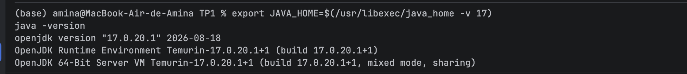
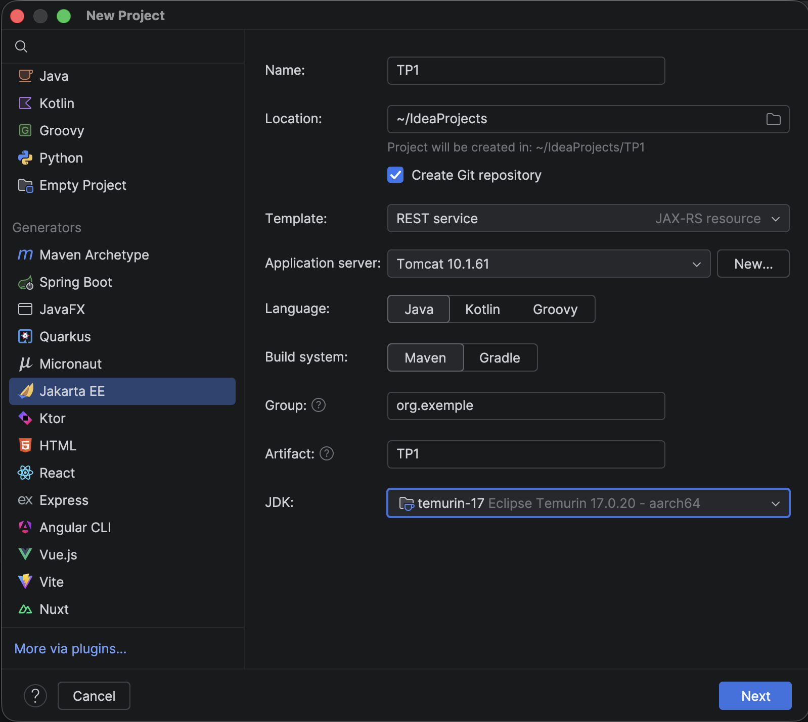
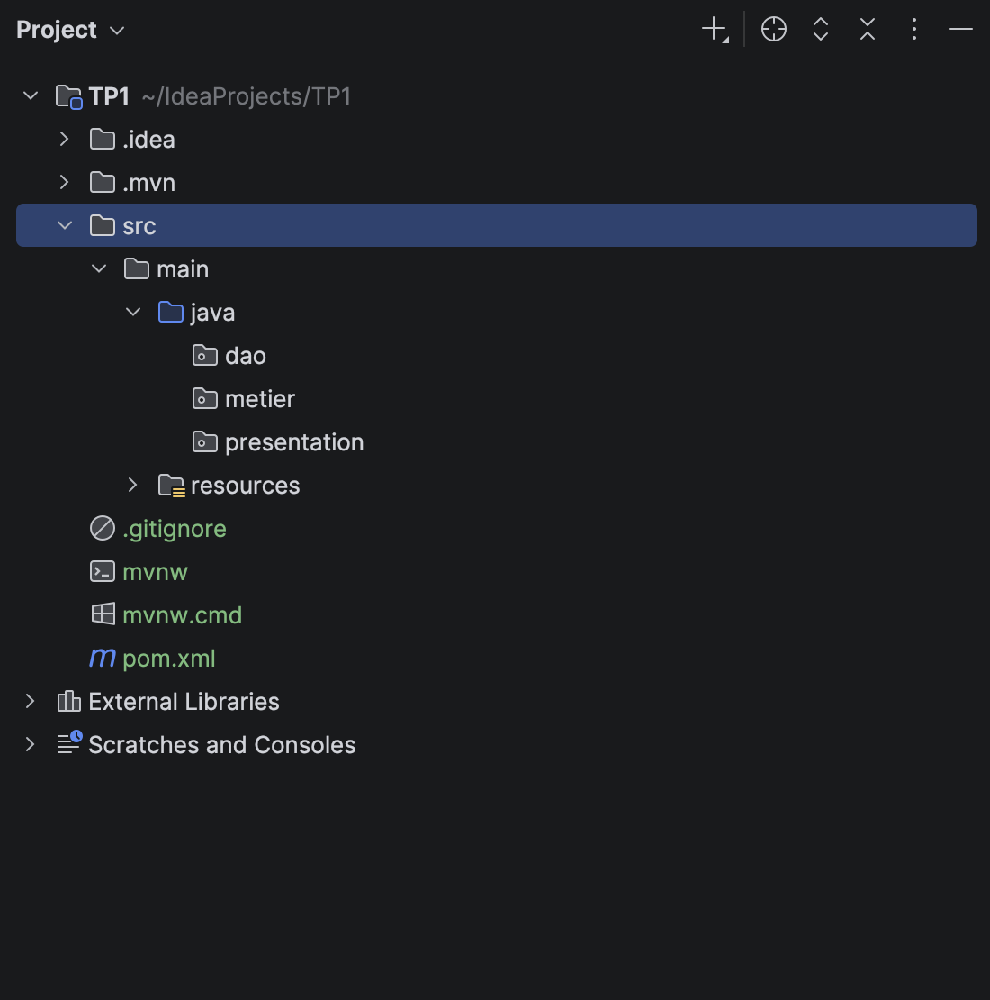
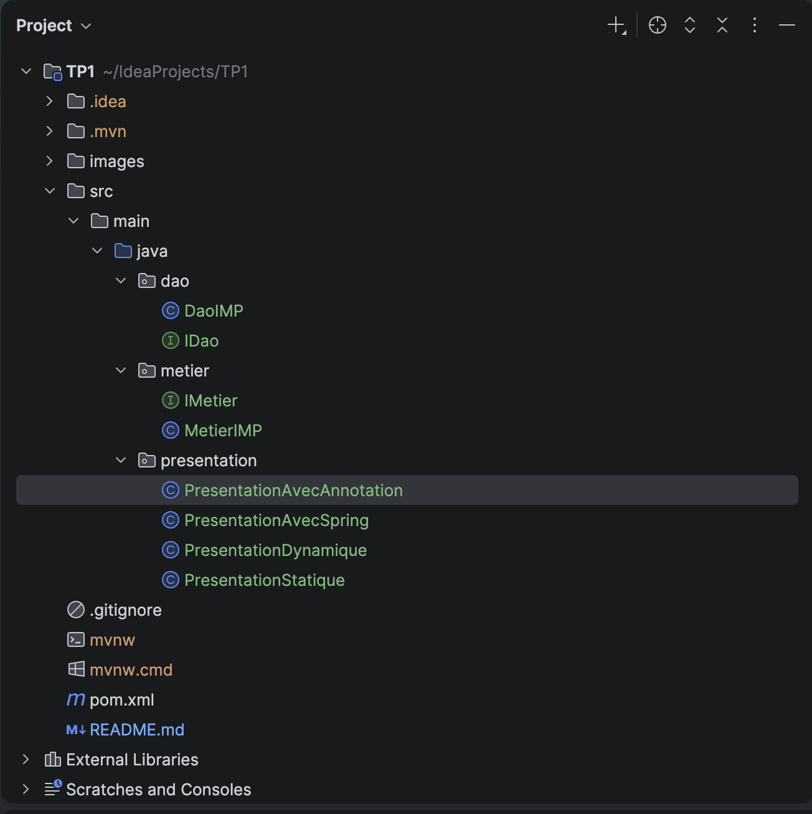
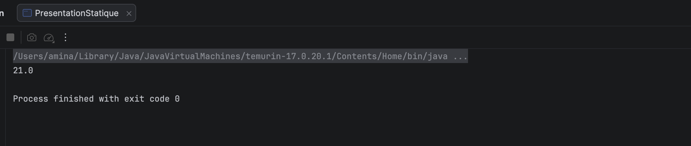
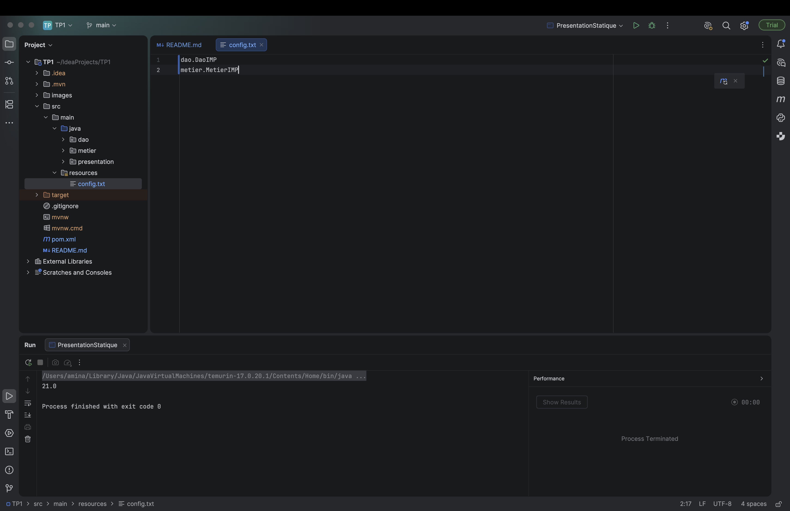
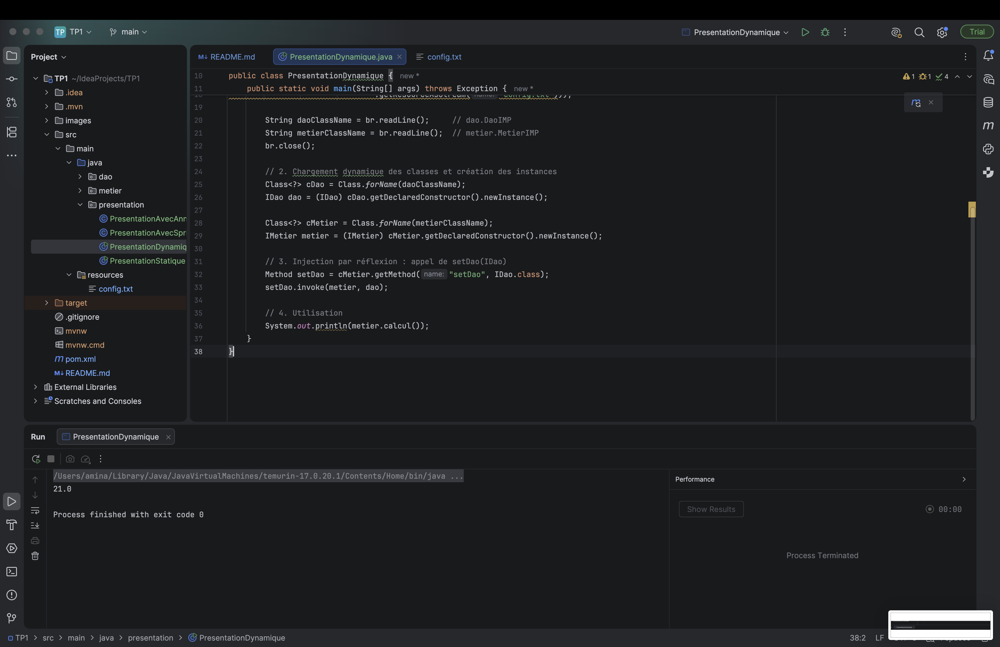
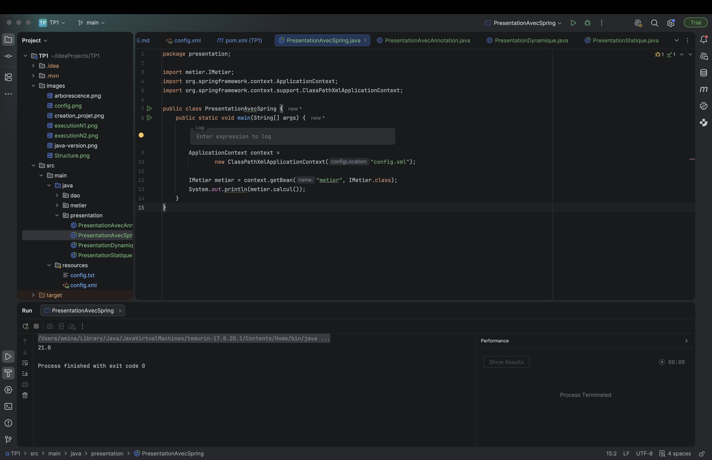
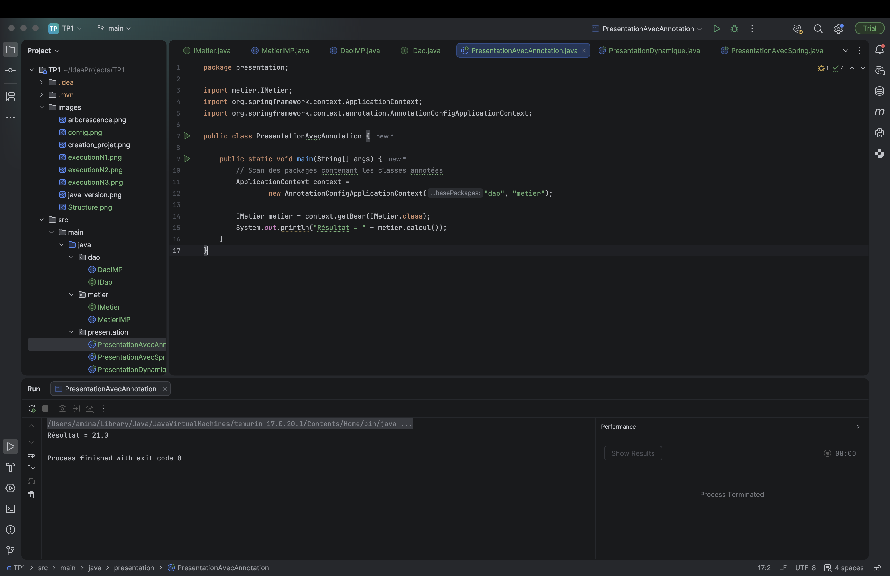

# TP1 : Inversion de Contrôle et Injection de Dépendances

|                         |                                                                                |
|-------------------------|--------------------------------------------------------------------------------|
| **Établissement**       | Faculté des Sciences de Sfax, Département d'informatique et des Communications |
| **Matière**             | Architecture MicroServices                                                     |
| **Filière**             | MPSRCC1                                                                        |
| **Étudiante**           | Amina Najar                                                                    |
| **Année universitaire** | 2026-2027                                                                      |

## 1. Objectif du TP

- Comprendre le principe de l'Inversion de Contrôle (IoC).
- Mettre en œuvre l'Injection de Dépendances (DI) à travers 4 approches :
    1. Injection de dépendances statique.
    2. Injection de dépendances dynamique via un fichier de configuration et la réflexion .
    3. Injection de dépendances avec Spring XML.
    4. Injection de dépendances avec les annotations Spring.

## 2. Environnement de travail
### 2.1 Environnement :

| Outil            | Version utilisée                                        |
|------------------|---------------------------------------------------------|
| Système          | macOS                                                   |
| JDK              | Eclipse Temurin 17.0.20.1                               |
| IDE              | IntelliJ IDEA 2026.2.3                                  |
| Maven            | Maven intégré à IntelliJ                                |
| Spring Framework | 7.0.8 (`spring-core`, `spring-beans`, `spring-context`) |
| Git              | 2.51.0                                                  |
### 2.2 Vérification de la version du JDK



*Figure 1 : Vérification de la version du JDK installé (Temurin 17.0.20.1)*
## 3. Création du projet

### 3.1. Création du projet Maven

Un nouveau projet nommé **TP1** est créé dans IntelliJ IDEA avec les paramètres suivants :

| Paramètre | Valeur |
|---|---|
| Name | TP1 |
| Location | `~/IdeaProjects` |
| Build system | Maven |
| Language | Java |
| GroupId | `org.exemple` |
| ArtifactId | `TP1` |
| JDK | Temurin 17 (Eclipse Temurin 17.0.20) |
| Git | Dépôt Git créé avec le projet |

<p align="center">
  
  <br>
  <em>Figure 2 : Création du projet Maven TP1 avec le JDK 17 dans IntelliJ IDEA.</em>
</p>

### 3.3 Création des packages

Pour respecter le design pattern **MVC**, trois packages ont été créés sous `src/main/java` :

| Package | Rôle |
|---|---|
| `dao` | Couche d'accès aux données : interface `IDao` et classe `DaoIMP` |
| `metier` | Couche métier : interface `IMetier` et classe `MetierIMP` |
| `presentation` | Couche de présentation : classes contenant la méthode `main` |

Le dossier `src/main/resources` accueillera les fichiers de configuration (`config.txt` pour l'activité 1-2 et `config.xml` pour l'activité 1-3).

<p align="center">
  
  <br>
  <em>Figure 3 : Arborescence du projet après création des packages</em>
</p>

### 3.4 Structure finale du projet

Chaque classe de la couche présentation correspond à une activité du TP :

| Classe | Activité | Mode d'injection |
|---|---|---|
| `PresentationStatique` | 1-1 | Instanciation statique |
| `PresentationDynamique` | 1-2 | Instanciation dynamique (`Class.forName`) |
| `PresentationAvecSpring` | 1-3 | Spring avec configuration XML |
| `PresentationAvecAnnotation` | 1-4 | Spring avec annotations |

```text
TP1
├── pom.xml
├── images/
└── src/
    └── main/
        ├── java/
        │   ├── dao/
        │   │   ├── IDao.java
        │   │   └── DaoIMP.java
        │   ├── metier/
        │   │   ├── IMetier.java
        │   │   └── MetierIMP.java
        │   └── presentation/
        │       ├── PresentationStatique.java
        │       ├── PresentationDynamique.java
        │       ├── PresentationAvecSpring.java
        │       └── PresentationAvecAnnotation.java
        └── resources/
            ├── config.txt
            └── config.xml
```

<p align="center">
  
  <br>
  <em>Figure 4 : Structure du projet dans IntelliJ IDEA</em>
</p>

## 4. Activité 1-1 : Injection de dépendances par instanciation statique

### 4.1. Création de l'interface `IDao` et de la classe `DaoIMP` dans le package `dao`

#### 4.1.1. Interface `IDao`

```java
package dao;

public interface IDao {
    double getValue();
}
```

#### 4.1.2. Classe `DaoIMP`

```java
package dao;

public class DaoIMP implements IDao {

    @Override
    public double getValue() {
        System.out.println("Version DaoIMP : accès à la source de données");
        return 42.0;
    }
}
```

### 4.2. Création de l'interface `IMetier` et de la classe `MetierIMP` dans le package `metier`

#### 4.2.1. Interface `IMetier`

```java
package metier;

public interface IMetier {
    double calcul();
}
```

#### 4.2.2. Classe `MetierIMP`

```java
package metier;

import dao.IDao;

public class MetierIMP implements IMetier {

    private IDao dao; // Dépendance vers l'interface IDao (couplage faible)

    @Override
    public double calcul() {
        if (dao == null) {
            throw new IllegalStateException("La dépendance IDao n'a pas été injectée.");
        }
        return dao.getValue() * 7;
    }

    // Setter utilisé pour l'injection de dépendances
    public void setDao(IDao dao) {
        this.dao = dao;
    }
}
```

### 4.3. Classe PresentationStatique : instanciation statique et injection de dépendances

```java
package presentation;

import metier.MetierIMP;

public class Presentation {

  public static void main(String[] args) {
    // Instanciation statique : les classes concrètes sont écrites en dur
    DaoIMP dao = new DaoIMP();
    MetierIMP metier = new MetierIMP();

    // Injection de la dépendance via le setter
    metier.setDao(dao);

    System.out.println("Résultat = " + metier.calcul());
  }
}
```

### 4.4. Exécution

**Résultat  :**

<p align="center">
   
  <br>
  <em>Figure 10 : Résultat de l'exécution de PresentationStatique (21.0)</em>
</p>

### 4.5 Analyse : couplage faible et Inversion de Contrôle

#### Question 9 : Comment cela illustre-t-il le couplage faible ?

Le couplage faible est respecté car `MetierIMP` dépend d'une **abstraction** (l'interface `IDao` et son contrat `getValue()`) et non de la classe concrète `DaoIMP`. La dépendance lui est fournie de l'extérieur par `setDao()`, donc on peut la remplacer par une autre implémentation de `IDao` (base de données, fichier...) sans modifier `MetierIMP`. Sans cette injection, `dao` vaudrait `null` et `calcul()` provoquerait une `NullPointerException`.

#### Question 10 : Le principe d'Inversion de Contrôle est-il respecté ? Justifier

Non, le principe d'IoC n'est pas respecté. C'est la classe `PresentationStatique` qui crée elle-même les objets (`new DaoIMP()`, `new MetierIMP()`) et qui réalise l'injection avec `setDao()`. Le contrôle de la création et de l'assemblage des objets reste donc dans le code de l'application, au lieu d'être confié à une entité externe. Pour changer d'implémentation, il faut modifier et recompiler cette classe.
#### Question 11 : Que faudrait-il modifier pour éviter que la classe de présentation contrôle directement la création des objets ?

Il faudrait supprimer les instanciations `new DaoIMP()` et `new MetierIMP()` de la classe de présentation et déléguer la création et l'injection des objets à une entité externe : soit un fichier de configuration avec instanciation dynamique (`Class.forName`), soit un conteneur IoC comme Spring. La classe de présentation ne ferait alors que récupérer les objets déjà assemblés, et changer d'implémentation ne nécessiterait plus de modifier le code.

## 5.Activité 1-2 : Injection de dépendances par instanciation dynamique
### 5.1 Création de la Classe `PresentationDynamique` 

La classe `PresentationDynamique` représente la couche de présentation de cette activité. Elle contient la méthode `main`, qui lira les noms de classes dans un fichier de configuration et créera les objets dynamiquement. 
### 5.2 Fichier de configuration `config.txt`
<p align="center">
  
  <br>
  <em>Figure 11 : Fichier de configuration config.txt</em>
</p>

### 5.3 Code de la clasee PresentationDynamique
package presentation;

import java.io.BufferedReader;
import java.io.InputStream;
import java.io.InputStreamReader;

public class PresentationDynamique {

    public static void main(String[] args) throws Exception {
        // Question 3 : lecture des noms de classes depuis config.txt
        InputStream is = PresentationDynamique.class.getResourceAsStream("/config.txt");
        BufferedReader br = new BufferedReader(new InputStreamReader(is));

        String daoClassName = br.readLine();      // 1re ligne : dao.DaoIMP
        String metierClassName = br.readLine();   // 2e ligne : metier.MetierIMP
        br.close();

        System.out.println("Classe DAO lue    : " + daoClassName);
        System.out.println("Classe métier lue : " + metierClassName);
    }
}
### 5.4 Chargement dynamique des classes avec `Class.forName`

#### Principe

Dans l'activité 1-1, les classes concrètes étaient écrites en dur dans le code (`new DaoIMP()`, `new MetierIMP()`). Ici, le code ne contient plus aucun nom de classe concrète : les noms lus dans `config.txt` sont des chaînes de caractères (`String`) et c'est la **réflexion Java** qui charge les classes correspondantes à l'exécution.

#### Étapes réalisées

1. **Chargement des classes** : `Class.forName(nom)` cherche dans le classpath la classe dont le nom complet (package + classe) est donné, la charge en mémoire et retourne un objet `Class`.
2. **Création des instances** : `getDeclaredConstructor().newInstance()` appelle le constructeur sans argument de la classe chargée et retourne un nouvel objet.
3. **Utilisation des interfaces** : les objets créés sont convertis (cast) vers `IDao` et `IMetier`. Le code de présentation ne manipule donc que des abstractions.

#### Code ajouté dans `PresentationDynamique`

```java
// Chargement dynamique des classes avec Class.forName
Class<?> cDao = Class.forName(daoClassName);
Class<?> cMetier = Class.forName(metierClassName);

// Création des instances à partir des classes chargées
IDao dao = (IDao) cDao.getDeclaredConstructor().newInstance();
IMetier metier = (IMetier) cMetier.getDeclaredConstructor().newInstance();
```

| Instruction | Rôle |
|---|---|
| `Class.forName(daoClassName)` | charge la classe `dao.DaoIMP` à partir de son nom |
| `Class.forName(metierClassName)` | charge la classe `metier.MetierIMP` à partir de son nom |
| `getDeclaredConstructor().newInstance()` | instancie la classe sans utiliser l'opérateur `new` |
| `(IDao)` / `(IMetier)` | cast vers les interfaces : aucune référence à `DaoIMP` ni `MetierIMP` |
### 5.5. Exécution

**Résultat :**

<p align="center">
  
  <br>
  <em>Figure 10 : Résultat de l'exécution de PresentationDynamique (21.0)</em>
</p>

### 5.6 Analyse : instanciation dynamique et Inversion de Contrôle

#### Question 7 : Comment cela illustre-t-il l'injection de dépendances par instanciation dynamique ?

Le code de `PresentationDynamique` ne contient aucun nom de classe concrète : les noms `dao.DaoIMP` et `metier.MetierIMP` sont lus dans `config.txt`, les classes sont chargées à l'exécution avec `Class.forName`, puis les objets sont créés par réflexion (`newInstance()`). La dépendance est ensuite injectée dans `MetierIMP` en appelant son setter `setDao()` par réflexion. Les objets sont donc créés et reliés à partir d'une configuration externe, et non par des `new` écrits dans le code.

#### Question 8 : En quoi cette approche se rapproche-t-elle davantage du principe IoC que l'activité 1-1 ?

Dans l'activité 1-1, la classe de présentation choisissait elle-même les classes concrètes (`new DaoIMP()`, `new MetierIMP()`). Ici, ce choix est déplacé dans un fichier externe : pour changer d'implémentation, il suffit de modifier `config.txt`, sans modifier ni recompiler le code. Le contrôle du choix des classes n'appartient donc plus au code applicatif, ce qui se rapproche du principe d'IoC. Ce n'est toutefois qu'un rapprochement : c'est encore notre propre code qui lit le fichier, crée les objets et fait l'injection.
#### Question 9 : Quels sont les avantages et les limites de cette solution ?

| Avantages | Limites |
|---|---|
| Changement d'implémentation sans modifier ni recompiler le code : il suffit de modifier `config.txt`. | Il faut écrire soi-même le code de lecture du fichier, de réflexion et d'injection : long et répétitif. |
| Couplage faible : le code ne manipule que les interfaces `IDao` et `IMetier`. | Les erreurs (nom de classe erroné, mauvais cast, constructeur absent) ne sont détectées qu'à l'exécution (`ClassNotFoundException`, `ClassCastException`...) et non à la compilation. |
| Application plus flexible et plus facile à faire évoluer. | La réflexion est plus lourde et moins lisible qu'un simple `new`. |
| Les classes concrètes ne sont plus écrites en dur dans le code de présentation. | Le format de `config.txt` est rudimentaire : il ne gère ni les dépendances multiples, ni les paramètres, ni la durée de vie des objets. |
| Premier pas vers l'IoC : le choix des classes est externalisé. | Ce n'est pas un vrai conteneur IoC : c'est encore notre code qui crée les objets et fait l'injection (rôle que Spring assurera ensuite). |
## 6. Activité 1-3 : Injection de dépendances avec Spring (configuration XML)

### 6.1 Configuration des beans dans `config.xml`

Le fichier `config.xml`, placé dans `src/main/resources`, déclare deux beans :

- `dao` : instance de la classe `dao.DaoIMP` ;
- `metier` : instance de la classe `metier.MetierIMP`, dans laquelle le bean `dao` est injecté par le setter `setDao()` grâce à `<property name="dao" ref="dao"/>`.

**Code de `config.xml` :**

```xml
<?xml version="1.0" encoding="UTF-8"?>
<beans xmlns="http://www.springframework.org/schema/beans"
       xmlns:xsi="http://www.w3.org/2001/XMLSchema-instance"
       xsi:schemaLocation="http://www.springframework.org/schema/beans
       https://www.springframework.org/schema/beans/spring-beans.xsd">

    <!-- Bean DAO -->
    <bean id="dao" class="dao.DaoIMP"/>

    <!-- Bean métier, avec injection du DAO par le setter setDao() -->
    <bean id="metier" class="metier.MetierIMP">
        <property name="dao" ref="dao"/>
    </bean>
</beans>
```
###6.2 la classe PresentationAvecSpring
package presentation;

import metier.IMetier;
import org.springframework.context.ApplicationContext;
import org.springframework.context.support.ClassPathXmlApplicationContext;

public class PresentationAvecSpring {
public static void main(String[] args) {
ApplicationContext context =
new ClassPathXmlApplicationContext("config.xml");

        IMetier metier = context.getBean("metier", IMetier.class);
        System.out.println(metier.calcul());
    }
}
### 6.3. Exécution

**Résultat :**

<p align="center">
  
  <br>
  <em>Figure 10 : Résultat de l'exécution de PresentationAvecSpring (21.0)</em>
</p>
### 6.4 Analyse : comparaison des approches

#### Question 6 : Comparaison avec l'activité 1-2 en termes de gestion des dépendances

| Critère | Activité 1-2 (réflexion + `config.txt`) | Activité 1-3 (Spring + `config.xml`) |
|---|---|---|
| Lecture de la configuration | Écrite à la main (`BufferedReader`) | Faite par le conteneur Spring |
| Création des objets | `Class.forName` + `newInstance()` dans notre code | Faite par Spring à partir des `<bean>` |
| Injection des dépendances | Appel manuel de `setDao()` par réflexion | Déclarative : `<property name="dao" ref="dao"/>` |
| Format de configuration | Fichier texte rudimentaire (deux noms de classes) | XML structuré (beans, propriétés, références) |
| Quantité de code | Importante et répétitive | Très réduite : `getBean()` suffit |
| Détection des erreurs | À l'exécution, au fil du code | Au démarrage du conteneur, avec des messages explicites |

Avec Spring, la gestion des dépendances est entièrement déléguée au conteneur : le code de présentation se contente de demander les beans déjà assemblés, alors que dans l'activité 1-2 nous devions écrire nous-mêmes toute la mécanique de lecture, d'instanciation et d'injection.

#### Question 7 : Différence entre création manuelle, création par réflexion et création par le conteneur Spring

| | Création manuelle (activité 1-1) | Création par réflexion (activité 1-2) | Création par le conteneur Spring (activité 1-3) |
|---|---|---|---|
| Principe | Opérateur `new` écrit dans le code | `Class.forName(nom)` puis `newInstance()` | Le conteneur lit `config.xml` et crée les beans |
| Qui choisit les classes ? | Le code (noms écrits en dur) | Un fichier de configuration lu par notre code | Un fichier de configuration lu par Spring |
| Qui fait l'injection ? | Le code (`setDao()`) | Le code (`setDao()` par réflexion) | Le conteneur (`<property ref>`) |
| Changer d'implémentation | Modifier et recompiler le code | Modifier `config.txt` | Modifier `config.xml` |
| Couplage avec les classes concrètes | Fort | Faible | Faible |
| Niveau d'IoC | Aucun : le code garde le contrôle | Partiel : le choix des classes est externalisé, mais le code crée et relie encore les objets | Complet : la création et l'assemblage sont confiés au conteneur |

En résumé : dans la création manuelle, le développeur contrôle tout ; avec la réflexion, il externalise seulement le choix des classes mais conserve le travail de création et d'injection ; avec Spring, ce contrôle est inversé et confié au conteneur, ce qui illustre pleinement le principe d'IoC.
## 7.Activité 1-4 : injection avec Spring et des annotations
### 7.1 Annotation des classes `DaoIMP` et `MetierIMP`

Les classes sont annotées avec les annotations Spring :

- `@Repository` sur `DaoIMP` : déclare un composant de la couche d'accès aux données ;
- `@Service` sur `MetierIMP` : déclare un composant de la couche métier ;
- `@Autowired` sur l'attribut `dao` de `MetierIMP` : demande à Spring d'injecter automatiquement un bean de type `IDao`.

```java
@Repository
public class DaoIMP implements IDao {
    @Override
    public double getValue() {
        return 3;
    }
}
```

```java
@Service
public class MetierIMP implements IMetier {

    @Autowired
    private IDao dao;

    @Override
    public double calcul() {
        return dao.getValue() * 7;
    }

    // Conservé pour que les activités 1-1 à 1-3 continuent de fonctionner
    public void setDao(IDao dao) {
        this.dao = dao;
    }
}
```

### 7.2 Scan des classes annotées : `PresentationAvecAnnotation`

`AnnotationConfigApplicationContext` scanne les packages `dao` et `metier`, détecte les classes annotées, crée les beans et réalise l'injection. Aucun fichier XML n'est nécessaire.

```java
ApplicationContext context =
        new AnnotationConfigApplicationContext("dao", "metier");

IMetier metier = context.getBean(IMetier.class);
System.out.println(metier.calcul());
```
### 7.3.Execution 
**Résultat**
**Résultat :**

<p align="center">
  
  <br>
  <em>Figure 10 : Résultat de l'exécution de PresentationAvecAnnotation </em>
</p>

### 7.4 Analyse : annotations Spring et Inversion de Contrôle

#### Question 5 : Comment Spring gère-t-il l'injection de dépendances à l'aide des annotations ?

Spring procède en quatre étapes :

1. **Scan** : `AnnotationConfigApplicationContext("dao", "metier")` parcourt les packages indiqués et repère les classes annotées par un stéréotype.
2. **Création des beans** : `@Repository` (sur `DaoIMP`) et `@Service` (sur `MetierIMP`) déclarent ces classes comme des composants. Spring les instancie lui-même et les range dans son conteneur.
3. **Injection** : `@Autowired` sur l'attribut `dao` de `MetierIMP` demande à Spring de chercher dans le conteneur un bean compatible avec le type `IDao`. Il trouve `DaoIMP` (qui implémente `IDao`) et l'injecte automatiquement, sans setter ni `<property>`.
4. **Récupération** : `context.getBean(IMetier.class)` retourne le bean `MetierIMP`, déjà complètement assemblé.

| Annotation | Rôle |
|---|---|
| `@Repository` | Déclare un composant de la couche d'accès aux données (`DaoIMP`) |
| `@Service` | Déclare un composant de la couche métier (`MetierIMP`) |
| `@Autowired` | Demande l'injection automatique de la dépendance, par son type |

#### Question 6 : Pourquoi cette solution est-elle plus maintenable que la configuration XML ? En quoi représente-t-elle une application complète du principe IoC ?

**Une solution plus maintenable**

| Configuration XML (activité 1-3) | Annotations (activité 1-4) |
|---|---|
| Un fichier `config.xml` à écrire et à tenir à jour en parallèle du code | Aucun fichier XML : la configuration est dans la classe elle-même |
| Chaque nouveau bean ou changement de nom de classe impose de modifier le XML | Il suffit d'annoter la nouvelle classe, elle est détectée par le scan |
| Les erreurs de nom ou de package dans le XML ne apparaissent qu'à l'exécution | Les noms de classes sont vérifiés par le compilateur et l'IDE |
| Risque de désynchronisation entre le code et le XML | Code et configuration au même endroit |
| Le XML devient lourd quand l'application grandit | Configuration légère, quel que soit le nombre de classes |

**Une application complète de l'IoC**

Dans cette activité, le code applicatif ne contient plus aucun `new`, aucune réflexion, aucune lecture de fichier et aucun appel à `setDao()`. Le développeur se contente de déclarer des composants (`@Repository`, `@Service`) et leurs besoins (`@Autowired`). C'est le conteneur Spring qui décide :

- **quand** créer les objets,
- **quelles** classes instancier (par le scan),
- **comment** les relier entre eux (par l'injection).

Le contrôle de la création et de l'assemblage des objets est donc entièrement inversé : il passe du code applicatif au conteneur. C'est exactement le principe d'IoC, appliqué ici de bout en bout, contrairement aux activités précédentes où le code gardait une part de ce contrôle.

## 8. Conclusion

Ce TP a permis de comparer quatre façons de créer des objets et de gérer leurs dépendances :

| Activité | Approche | Qui crée et relie les objets ? | Niveau d'IoC |
|---|---|---|---|
| 1-1 | Instanciation statique (`new`) | Le code de présentation | Aucun |
| 1-2 | Réflexion (`Class.forName`) + `config.txt` | Notre code, d'après un fichier externe | Partiel |
| 1-3 | Spring + `config.xml` | Le conteneur Spring | Élevé |
| 1-4 | Spring + annotations | Le conteneur Spring | Complet |

Le couplage faible, obtenu grâce aux interfaces `IDao` et `IMetier`, est présent dès l'activité 1-1. Ce qui évolue d'une activité à l'autre, c'est **la responsabilité de la création et de l'assemblage des objets** : elle passe progressivement du code applicatif vers un conteneur, ce qui rend l'application plus flexible, plus facile à maintenir et à faire évoluer.